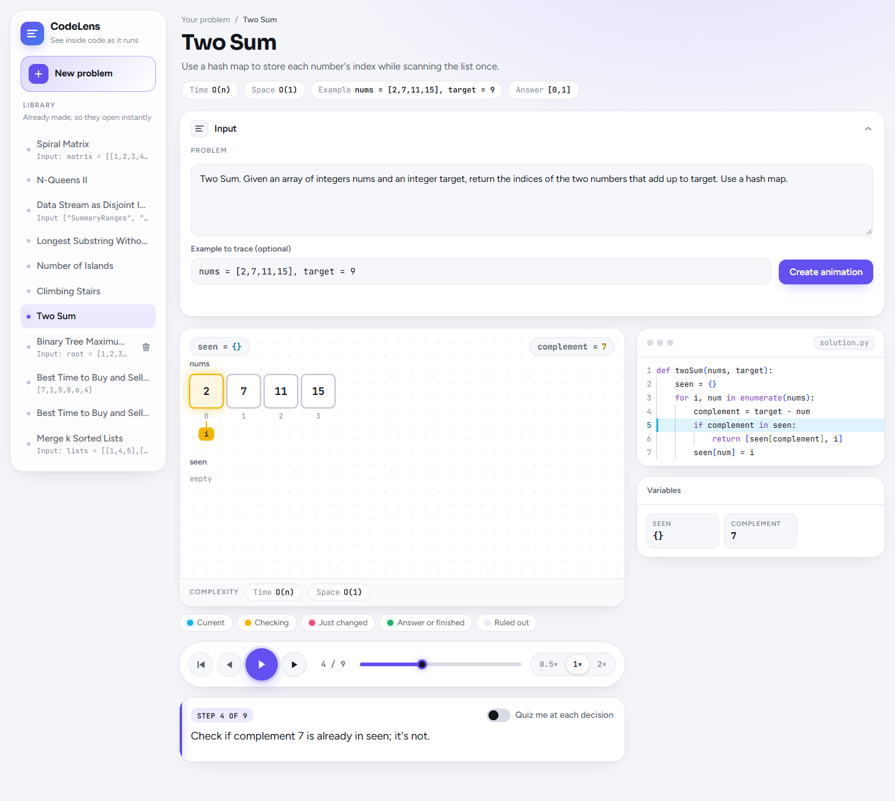
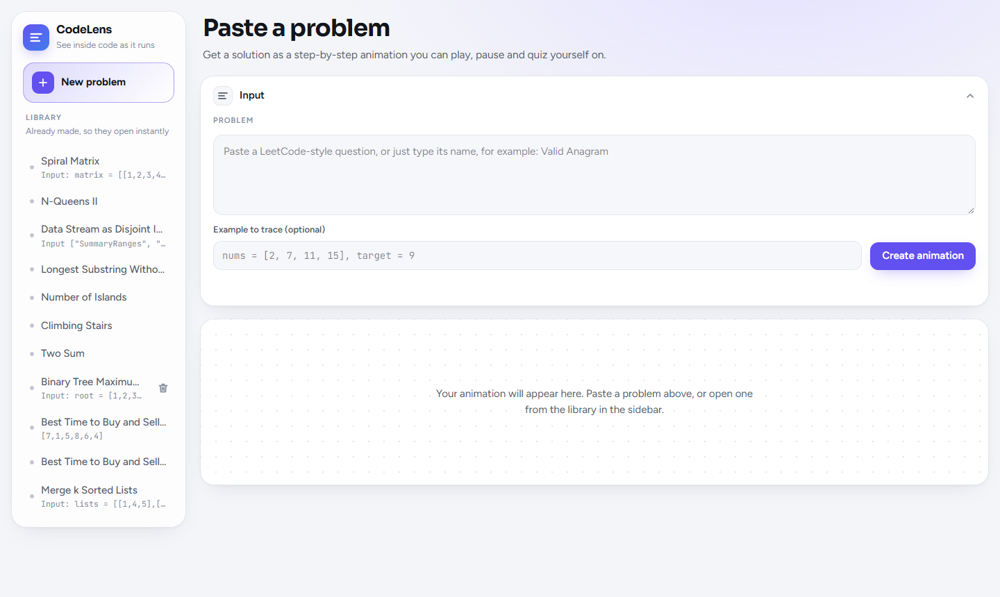
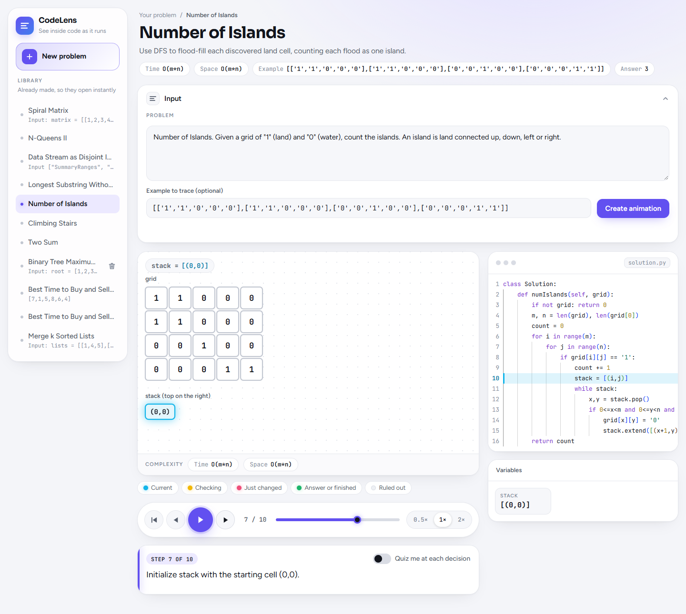
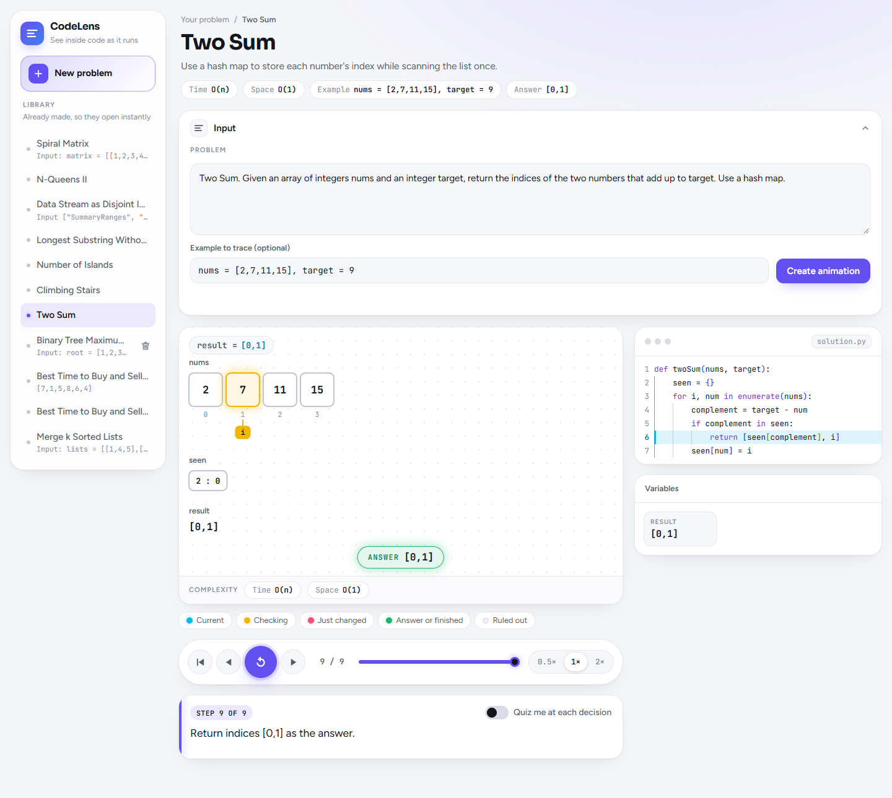
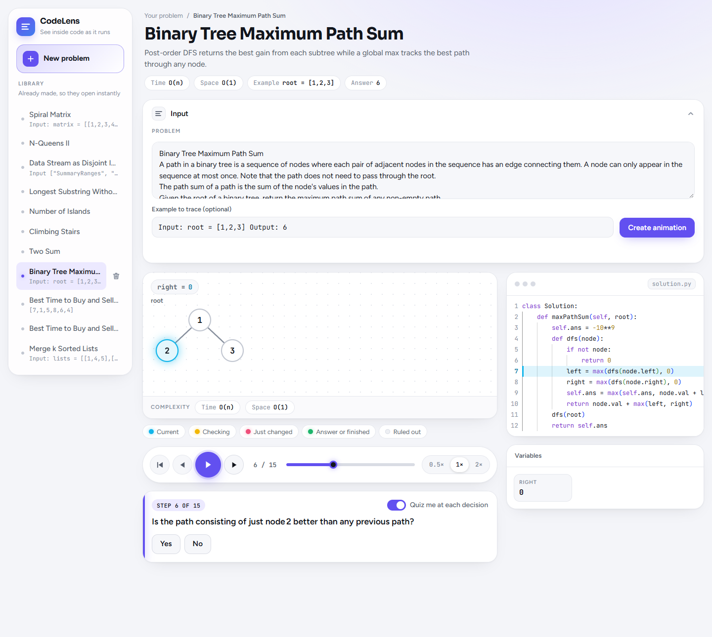
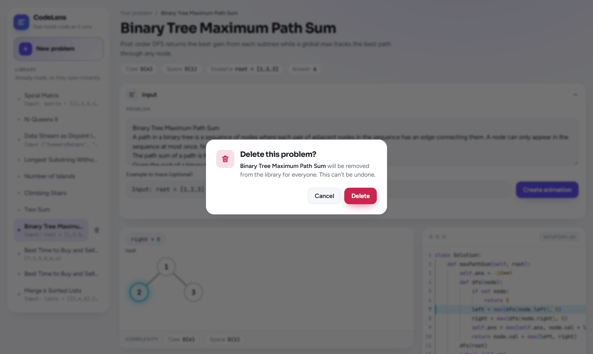

# CodeLens

Paste a coding problem and watch its solution run, one step at a time. CodeLens turns a
LeetCode-style question into an animated dry run: the data moves on screen, the current line of code
lights up, and every variable updates as you step through.



## Features

### Paste a problem, get an animation

Paste the full question, or just type its name, for example `Valid Anagram`. You can add your own
example to trace; leave it empty and one is picked for you. Press **Create animation** and the
walkthrough is built and saved.



### Step through the solution

Each step shows three things side by side:

- **The stage**: arrays, grids, stacks, maps and pointers drawn as boxes that glide to their new
  places as the algorithm runs. Colours show what is current, being checked, just changed, part of
  the answer, or ruled out.
- **The code**: the solution with the line that runs in this step highlighted.
- **Variables**: the value of every variable at this moment.

A short sentence under the player explains what happens in the step.



### Playback controls

Play, pause, step forward or back, restart, drag the slider to jump to any step, and pick a speed
(0.5×, 1× or 2×). Keyboard shortcuts: **→** next step, **←** previous step, **Space** play or pause.

### Answer and complexity

The header shows the problem's time and space complexity, the example being traced and the final
answer. When playback reaches the end, the answer appears on the stage.



### Quiz mode

Turn on **Quiz me at each decision** and the player stops before key moments to ask what happens
next. Pick an answer to see if you were right, then carry on.



### Shared library

Every walkthrough anyone makes is saved to a shared library in the sidebar, so it opens instantly
next time. There is one walkthrough per problem: asking for a problem that is already in the
library opens the saved one instead of making a duplicate. **New problem** clears the screen for
the next question.

### Delete your own problems

A trash icon appears next to the problems your browser created. Deleting asks for confirmation
first, and other people's problems can't be deleted.



### Light and dark

The app follows your system's light or dark setting and works on phones as well as desktops.

## Run it

The frontend needs the [backend](../backend/README.md) running for the library and for new
animations.

```bash
npm install
npm run dev        # http://localhost:3000
```

Every call to `/api/*` is proxied by Next.js to the backend at `BACKEND_URL`, which defaults to
`http://localhost:5000`. To use another address, set it in `.env.local`:

```bash
BACKEND_URL=http://localhost:5000
```

## Checks

```bash
npm run typecheck
npm run lint
npm run format:check
npm run build
```

## Tech

Next.js, React, TypeScript, Tailwind CSS, Framer Motion and Monaco Editor.

## Layout

```
src/app/                       Next.js routes: the page, layout, theme tokens
src/shared/                    HttpClient, useHttpClient
src/features/code-lens/
  CodeLensPage.tsx             Composes the page
  components/<Name>/<Name>.tsx One component per folder
  hooks/                       Player, current walkthrough, generator, library
  utils/                       Scene layout, panel layout, walkthrough validation, problem key
  services/                    API calls
  styles/                      Shared Tailwind class maps
  types/                       Scene, step and walkthrough types
docs/screenshots/              Images used in this README
```

Each step holds a scene (data only). `utils/scene-layout.ts` turns a scene into positioned nodes,
edges and labels with stable keys. The stage renders them with Framer Motion, so an item with the
same key glides from its old place to its new one.
